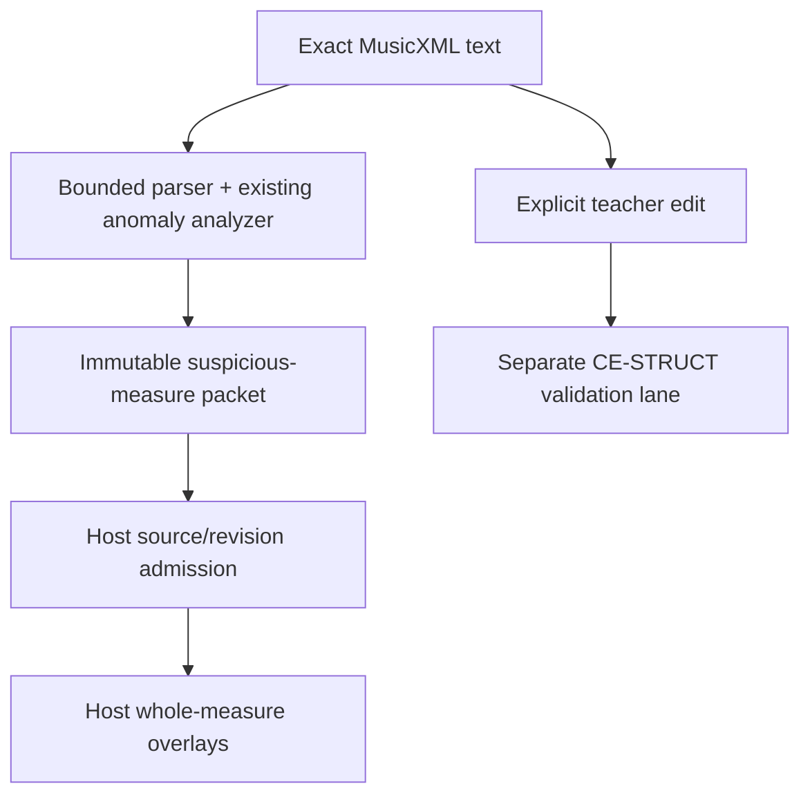

# Architecture

## System boundary

`ST OMR Correction Engine` is a fail-closed semantic correction layer downstream of an OMR provider and upstream of host-side review/revalidation.

It does not replace Audiveris or another OMR recognizer. It consumes structured score evidence and validator findings, reasons about likely musical/structural errors, produces bounded correction proposals, and abstains when evidence is insufficient.

```text
OMR provider / imported MusicXML
        |
        v
Canonical ScoreGraph + host findings/evidence
        |
        v
Detectors / constraints
(pitch, duration, onset, tie, tuplet, staff, meter, polyphony)
        |
        +--------------------------+
        |                          |
        v                          v
Structural suggestion builder   Polyphonic voice solver
        |                          |
        +------------+-------------+
                     v
          Candidate resolver / abstention
                     |
                     v
          Reversible correction patches
                     |
                     v
        Shadow projection / safe in-memory projection
                     |
                     v
       Independent revalidation v2
                     |
                     v
      REAL_OMR correction-readiness gate
                     |
          +----------+----------+
          |                     |
          v                     v
     review/shadow         authorized narrow apply
                           (E11A voice-only)
```

The engine never grants itself production authority from a proposal alone.

## Implemented architecture layers

1. **Contracts and canonical correction model**
   - stable score/event identities;
   - versioned error taxonomy;
   - explicit evidence and correction-result contracts;
   - first-class abstention / ambiguous outcomes.

2. **Bounded analysis**
   - meter/rhythm/onset constraints;
   - pitch anomaly detection;
   - duration anomaly detection;
   - staff anomaly detection;
   - tie anomaly detection;
   - tuplet anomaly detection;
   - cross-staff reasoning;
   - polyphony-complexity metadata.

3. **Candidate generation and resolution**
   - bounded candidate graph;
   - structural suggestion builder;
   - polyphonic voice solver;
   - resolver requiring explicit evidence rather than “measure sums correctly” heuristics.

4. **Patch, projection and reversibility**
   - bounded operations for pitch, onset, voice, duration, staff and tie;
   - stale-`before` protection;
   - immutable source graph;
   - exact patch reversal;
   - unsupported generic relation mutation fails closed.

5. **Independent revalidation**
   - projected revisions are rechecked independently;
   - only fields authorized by the patch may change;
   - source/event identity and measure structure remain stable;
   - revert must reproduce the source graph.

6. **Evidence and benchmark layer**
   - teacher-gold correction-event schema;
   - REAL_OMR provenance/integrity eligibility;
   - source-level split leakage protection;
   - selective prediction and risk/coverage metrics;
   - confidence-calibration research harness;
   - teacher workload telemetry.

7. **Readiness layer**
   - generic ladder:
     `RESEARCH_ONLY → SHADOW_READY → TEACHER_REVIEW_READY → AUTO_CORRECTION_CANDIDATE → PRODUCTION_APPROVED`;
   - REAL_OMR-specific correction gate counts only gold-eligible, teacher-accepted, correction-needed real OMR evidence;
   - `NO_CORRECTION_NEEDED`, controlled mutation and synthetic labels cannot promote an expanded class to automatic correction;
   - automatic-correction candidacy additionally requires explicit `correctionSafe === true` evidence.

8. **Host adapters**
   - SesliTab shadow adapter exposes expanded end-to-end correction analysis without write-back;
   - ScoreMosaic integration remains shadow/evidence only;
   - core does not depend on host UI, playback, TAB, authentication, deployment or provider runtime.

## CE-STRUCT-01 teacher-authorized structural correction boundary

CE-STRUCT-01 is deliberately separate from the normal correction-patch and automatic-correction lane:

```text
explicit teacher editor action
        |
        v
TeacherStructuralPatchSetV1
        |
        v
exact base sourceId + graph fingerprint gate
        |
        v
atomic immutable structural projection
        |
        v
independent structural diff + detector revalidation
        |
        v
exact rollback proof
        |
        v
read-only SesliTab host packet
```

The structural operation vocabulary is limited to event insert/remove, event duration/voice/staff/tie changes, and meter change on an existing measure. Insert/remove operations carry an exact event-array `eventIndex` so non-final event deletion is exactly reversible without reordering the base graph. It is not added to `PATCH_OPERATION`, and `controlledAutoCorrection.js`, resolver/candidate authority, REAL_OMR readiness, and E11A remain unchanged.

Teacher-edit authorization is an audit proof that the host supplied an explicit edit. It is not final teacher approval. A structural integrity `PASS` can make a host revision eligible to be represented as teacher-corrected, but it cannot mark the score teacher-approved, share it with a student, persist it for learning, serialize corrected MusicXML, or enable unattended automatic correction.

## CE-STRUCT browser runtime boundary

The CE-STRUCT browser artifact is a packaging boundary, not a second correction engine:

```text
same CE-STRUCT source modules
        |
        v
bounded browser entry
        |
        v
esbuild IIFE bundle
        |
        +--> exact checked-out engine revision
        +--> artifact SHA-256 manifest
        +--> zero external imports
```

The browser build aliases only the `node:crypto` SHA-256 call used for ScoreGraph fingerprinting to a tested browser-compatible SHA-256 shim. Node and browser behavior are qualified for the admitted structural operations and rollback semantics; the browser-specific code may not fork projection or revalidation logic.

Pull-request CI checks out the actual PR head SHA before qualification, and the runtime manifest must match that same `git HEAD`. The artifact has no network, persistence, authentication, automatic apply, final teacher approval, student sharing, learning or MusicXML write-back authority. No Render/service/domain is part of this boundary.

## Read-only browser analysis and host presentation boundary

PR #99 / SES-112 adds a second, separate browser artifact:



`src/correction/musicXmlSuspiciousMeasureAnalyzer.js` calls `parseBoundedMusicXmlScoreGraph(..., { includeRests: true })` and `analyzeOmrCorrections`. It groups findings by measure and emits `ST_OMR_CORRECTION_ENGINE_SUSPICIOUS_MEASURES_V1`: `sourceId`, text-byte `sourceHash`, `partId`, measure/event counts, findings, ordered suspicious measures and `unmappedFindingCount`. Measure indices are zero-based; measure numbers remain strings. `sourceGraphMutated`, `automaticApplyAuthority` and `musicXmlWriteBackAuthority` are false.

The parser admits one score-partwise part, timed notes/rests, chord members, backup/forward, voice/staff, simple tie metadata and inherited divisions/meter. It explicitly rejects multi-part input, nonzero chromatic transposition, missing required timing data and backup before measure start. This is a bounded regex-based canonicalizer, not a general MusicXML schema validator; do not infer complete coverage of unsupported notation from the fail-closed tests.

`browser/ceAnalysisBrowserEntry.js` exports the analysis function plus contract/version metadata. `scripts/buildCeAnalysisBrowserRuntime.mjs` builds `dist/browser-analysis/ce-analysis-browser-runtime.js` and its manifest with global `STOmrCorrectionAnalysisRuntime`, IIFE/ES2022 format, zero external imports, exact checked-out commit, byte size and SHA-256. SHA-256/Buffer shims preserve admitted Node/browser behavior; filesystem access is unavailable. Network, persistence, authentication, automatic apply, learning and MusicXML write-back capability/authority flags are false.

The engine emits diagnostics, not DOM or renderer changes. Host code owns exact source/revision matching, overlay mapping, cancellation, clearing and refresh after accepted edits. SES-111 and SES-114 are recorded Done in Linear; those historical integration completions do not establish current live behavior. SES-263 remains Todo for stale suspicious marks after correction/reanalysis. Its root cause and fix are unverified in this documentation sync.

## SEM-05 shadow semantic consistency boundary

SEM-05 adds an adapter-only reference path:

```text
exact source MusicXML
  +--> existing bounded OMR canonicalizer --> immutable ScoreGraph
  |
  +--> pinned ST Score Semantic Engine --> SemanticSnapshot + provenance
                                      |
                                      v
                         SemanticConsistencyPacketV1
```

The packet is diagnostic/revalidation evidence only. Since both interpretations derive from the same source MusicXML, it cannot satisfy the resolver's independent-evidence-source requirement and is deliberately not represented with the normal `createEvidence()` contract. `EVIDENCE_SOURCE`, candidate confidence, resolver policy, teacher-gold provenance, REAL_OMR readiness and E11A remain unchanged.

The admitted profile is bounded and fail-closed: one part, pitched non-rest notes, fixed divisions, full non-implicit measures, structural note comparison, simple tie roles and meter. No Python/Partitura runtime, network service, Render dependency, patch production, source mutation or MusicXML write-back is introduced.

## CE-E2E correction surface

CE-E2E-01 completed the executable proposal path for deterministic targets:

- pitch;
- duration/rhythm;
- onset;
- voice;
- staff;
- bounded tie changes.

Tuplet and cross-staff logic remain analysis/evidence surfaces when a safe exact mutation target is not available.

CE-E2E-02 added the fail-closed REAL_OMR readiness gate so that engineering capability cannot be mistaken for scientific evidence of safe unattended correction.

## Production automatic-correction boundary

E11A remains the only authorized automatic-correction slice.

A controlled automatic correction is limited to exactly one high-confidence `CHANGE_VOICE` patch and requires:

- resolver status `RESOLVED`;
- confidence at least `0.90`;
- at least two independent evidence sources;
- immutable projection success;
- mandatory post-projection independent/host revalidation;
- explicit `ACCEPT` result.

`REVIEW`, `BLOCK`, missing revalidation, failed projection or failed revalidation leaves the source graph selected.

There is no production MusicXML overwrite or corrected-MusicXML serialization path.

## Evidence boundary verified 2026-10-28

Current approved REAL_OMR evidence remains deliberately small:

- the original known-correct Audiveris source: 22 score events, 54 `NO_CORRECTION_NEEDED` labels;
- SES-97 / PR #95: one eligible teacher-accepted DURATION correction-needed event from an independent Franz Benda source, `correctionSafe=false`;
- together, those event-label sets contain 55 eligible labels across 2 independent sources, but only 1 correction-needed source and 0 correction-safe accepted events;
- SES-110 / PR #98: a separate teacher-verified Sor structural-failure packet for measures 21/28/29/31; `readinessEligible=false`, `patchEligible=false`, exact teacher patch values absent;
- no source-separated real correction-engine confidence calibration has been demonstrated by this sync.

With the lower evidence gates explicitly supplied, the combined event-label regression reaches `TEACHER_REVIEW_READY` and refuses `AUTO_CORRECTION_CANDIDATE`. This is a tested readiness scenario, not a global production promotion. The structural packet does not add four event-level gold corrections. See [Evidence Readiness](EVIDENCE_READINESS.md).

Therefore pitch, duration, onset, staff, tie, tuplets, cross-staff, Voice 3 and Voice 4 must not be promoted to broad unattended production correction solely from the current repository evidence.

## Dependency direction

Core contracts, analysis, resolver, patching, validation and readiness do not depend on adapters or optional AI.

Adapters depend on core contracts.

Optional AI may contribute evidence through explicit contracts, but it is never semantic authority and may not bypass readiness or teacher provenance.

## Non-goals / closed boundaries

The current architecture does not authorize:

- Audiveris runtime/provider modification;
- production MusicXML overwrite;
- SesliTab production write-back;
- ScoreMosaic winner selection or automatic patch merge;
- machine-generated teacher provenance;
- multi-patch unattended correction transactions;
- automatic pitch/duration/onset/staff/tie/tuplet/cross-staff mutation outside a separately approved evidence gate;
- confidence-threshold reduction;
- external AI dependency as a required production authority;
- universal OMR accuracy claims.
